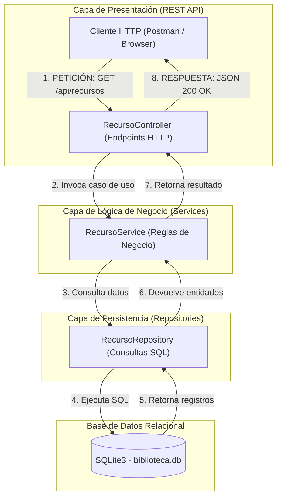

# 📚 Sistema de Gestión Bibliotecaria (SGB) - Universidad de Madeira


Este repositorio contiene la **base técnica (esqueleto funcional)** para el Sistema de Gestión Bibliotecaria de la Universidad de Madeira, desarrollado para el **Segundo Momento Evaluativo** de la asignatura Desarrollo de Software II.

---

## 🏗️ Arquitectura del Sistema (N-Tier / Por Capas)

Para garantizar la separación de responsabilidades, alta mantenibilidad y bajo acoplamiento, se implementó una **Arquitectura por Capas (N-Tier)** dividida en cuatro componentes principales:

1. **Capa de Presentación / Controladores (`src/controllers`):** Encargada de exponer los endpoints REST API, recibir las peticiones HTTP y devolver las respuestas al cliente.
2. **Capa de Lógica de Negocio (`src/services`):** Contiene los casos de uso, reglas de negocio y validaciones del dominio.
3. **Capa de Persistencia / Repositorios (`src/repositories`):** Aísla las consultas SQL y la interacción directa con la base de datos.
4. **Capa de Base de Datos (`src/config`):** Gestiona la conexión relacional mediante `SQLite3` (`biblioteca.db`).

---

## 🔄 Flujo de Información End-to-End

El sistema garantiza un flujo completo de datos desde la interfaz/petición externa hasta la base de datos relacional y de regreso:



---

## 📁 Estructura del Proyecto

```text
SGB-Universidad-Madeira/
├── src/
│   ├── config/
│   │   └── database.js           # Conexión e inicialización de SQLite
│   ├── controllers/
│   │   └── recursoController.js  # Endpoints y manejo de HTTP
│   ├── repositories/
│   │   └── recursoRepository.js  # Capa DAO / Consultas SQL
│   ├── services/
│   │   └── recursoService.js     # Lógica de negocio
│   └── app.js                    # Servidor Express y rutas REST
├── .gitignore                    # Exclusión de node_modules
├── package.json                  # Dependencias del proyecto
└── README.md                     # Documentación de la arquitectura
```

---

## 🚀 Instrucciones para Ejecución Local

### Prerrequisitos

- Node.js (v18 o superior)
- npm (incluido con Node.js)

---

## Pasos de Instalación

1. Clonar el repositorio:

    ```bash
    git clone https://github.com/GMort01/SGB-Universidad-Madeira.git
    ```

2. Entrar en el directorio del proyecto:

    ```bash
    cd SGB-Universidad-Madeira
    ```

3. Instalar las dependencias:

    ```bash
    npm install
    ```

4. Iniciar el servidor:

    ```bash
    node src/app.js
    ```

5. Probar la API desde el navegador o un cliente HTTP como Postman o Thunder Client:

    ```text
    http://localhost:3000/api/recursos
    ```

## 👥 Información del Proyecto
**Estudiante:** Manuel Morales Martínez

**Institución:** Fundación Universitaria Católica Lumen Gentium - UNICATÓLICA

**Curso:** Desarrollo de Software II

**Docente:** Fabian Stiven Valencia Córdoba